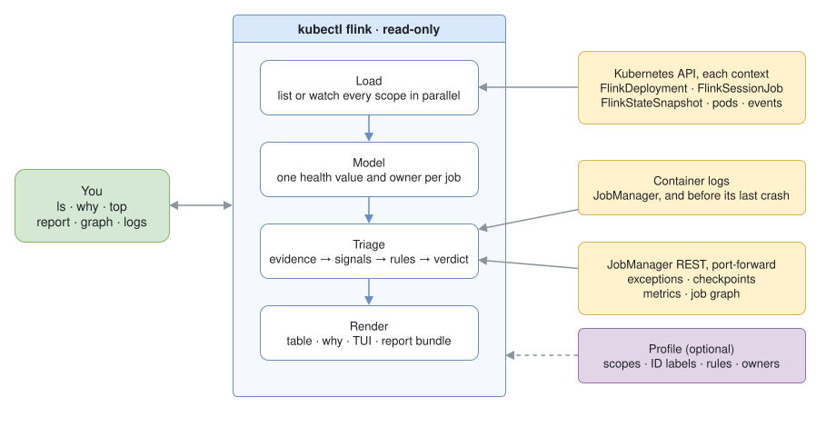

# kubectl flink

A kubectl plugin and terminal UI for the [Apache Flink Kubernetes Operator](https://github.com/apache/flink-kubernetes-operator).
It gives every `FlinkDeployment` and `FlinkSessionJob` one health value, and explains a failing job with its evidence:
operator, Kubernetes, Flink runtime and performance. Across hundreds of jobs and several clusters, read-only.

<p align="center">
  <picture>
    <source media="(prefers-color-scheme: light)" srcset="https://github.com/patrk/kubectl-flink/releases/download/demo/highlights-light.gif">
    
  </picture>
</p>

More recordings, each next to the classic way: [docs/demos.md](docs/demos.md).

## How it works



- `ls` and `top` read only the Kubernetes API: one list per resource kind and namespace, in parallel, or a watch.
- `why`, `report` and the TUI's job screen also read the JobManager's logs and its REST API, through a port-forward.
- An optional profile adds the scopes to read, the labels people name jobs by, own verdict rules, and owners.

## Quickstart

```sh
kubectl krew install flink                 # krew index pending; until then: github.com/patrk/kubectl-flink/releases
make kind-up demo                          # optional, from a clone: kind with the operator and example jobs
```

```sh
kubectl flink ls -A                        # every job, one health value each
kubectl flink ls -A --unhealthy -o wide    # only what is broken, with TaskManagers, drift, image and owner
kubectl flink ls -A 4711                   # jobs by a business ID label, or by part of the name
kubectl flink why orders/order-export      # the cause first, then the evidence by layer
kubectl flink top -A                       # live TUI: / search, f unhealthy, Enter a job, R report, ? keys
kubectl flink report order-export          # handover bundle for a ticket, secrets redacted
kubectl flink exceptions | checkpoints | snapshots | graph | logs | history <job>
kubectl flink config view                  # the profile in force for this context
```

`ls` also takes `-l selector`, `--health failed,stuck`, `--sort`, `-o json|yaml|name`, `-w` and `--exit-code`.
Tab completion: put `kubectl_complete-flink`, shipped in the archive next to the plugin, on your PATH.

> **Early development.** Everything above works. Planned: `ui`, and `savepoint`, `restart`, `suspend` and `resume`
> with dry run, owner warnings and `--wait`.

Apache License 2.0. Not affiliated with the Apache Software Foundation; Apache Flink is its trademark.
