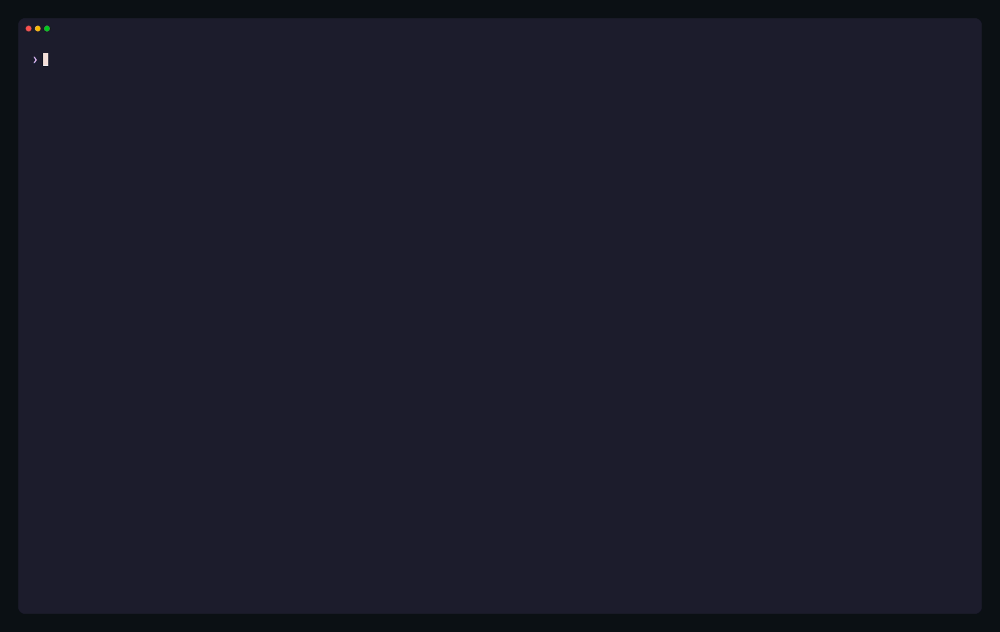
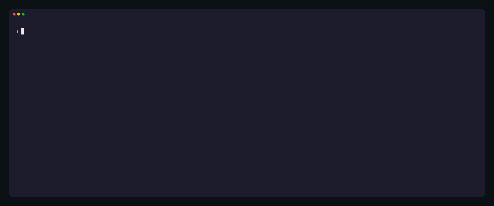

# Demos

Recorded against the operator on kind with the example jobs of `make demo`; nothing is edited.

## The classic way, then one command

`kubectl get` shows no health, `describe` keeps the cause in a JSON string, and the log ends in stack frames. `kubectl flink` lists what is unhealthy and names the cause with its evidence.

<picture>
  <source media="(prefers-color-scheme: light)" srcset="demo/classic-light.gif">
  
</picture>

## A crash loop, from alert to handover

`top` filters to the unhealthy jobs and opens one: its verdict, then the log of the container before the last crash, then `R` writes the handover bundle whose `summary.md` goes into the ticket.

<picture>
  <source media="(prefers-color-scheme: light)" srcset="demo/crashloop-light.gif">
  
</picture>

## Where a job's time goes

Each operator's busy, back-pressured and idle time and its rates, coloured as the Flink web UI colours its job graph, as text or as JSON.

<picture>
  <source media="(prefers-color-scheme: light)" srcset="demo/graph-light.gif">
  
</picture>

## Jobs by the IDs people use

A use-case ID in a label, a team label, and `why` on an ID in another namespace.

<picture>
  <source media="(prefers-color-scheme: light)" srcset="demo/ids-light.gif">
  
</picture>

